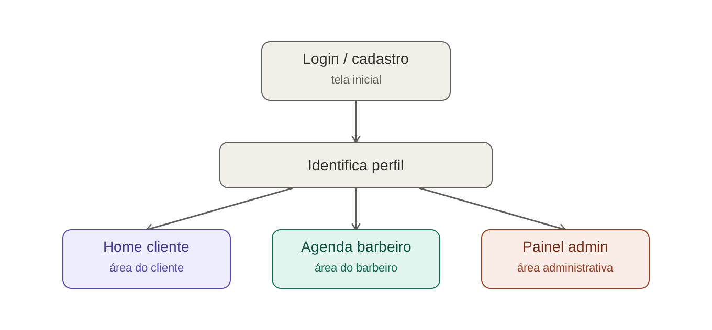
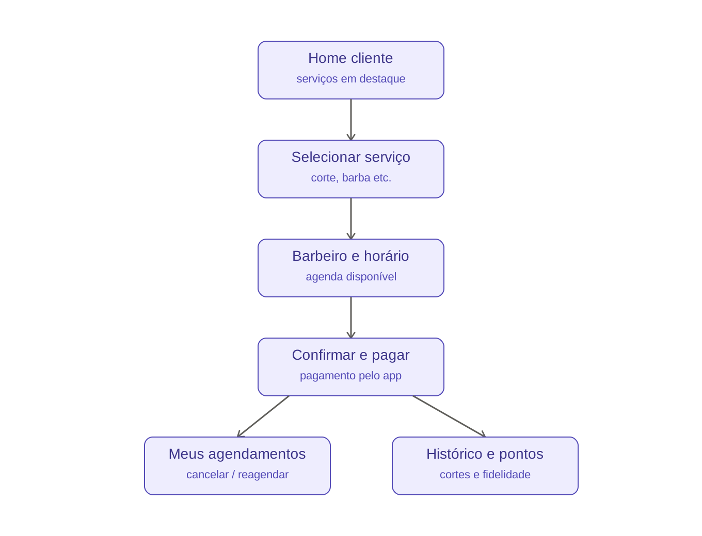
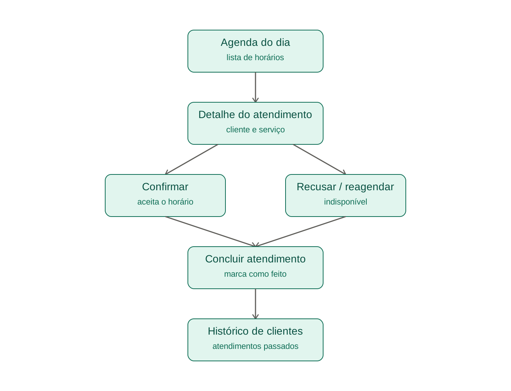
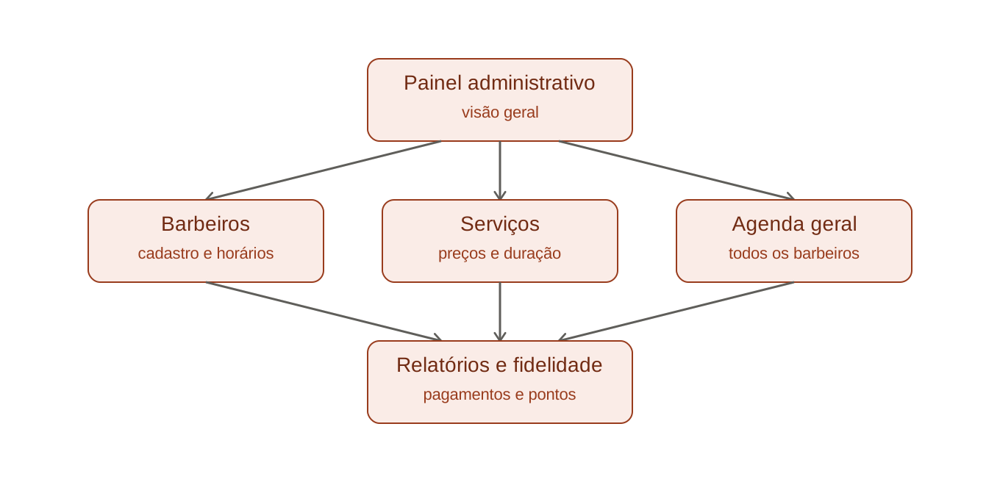
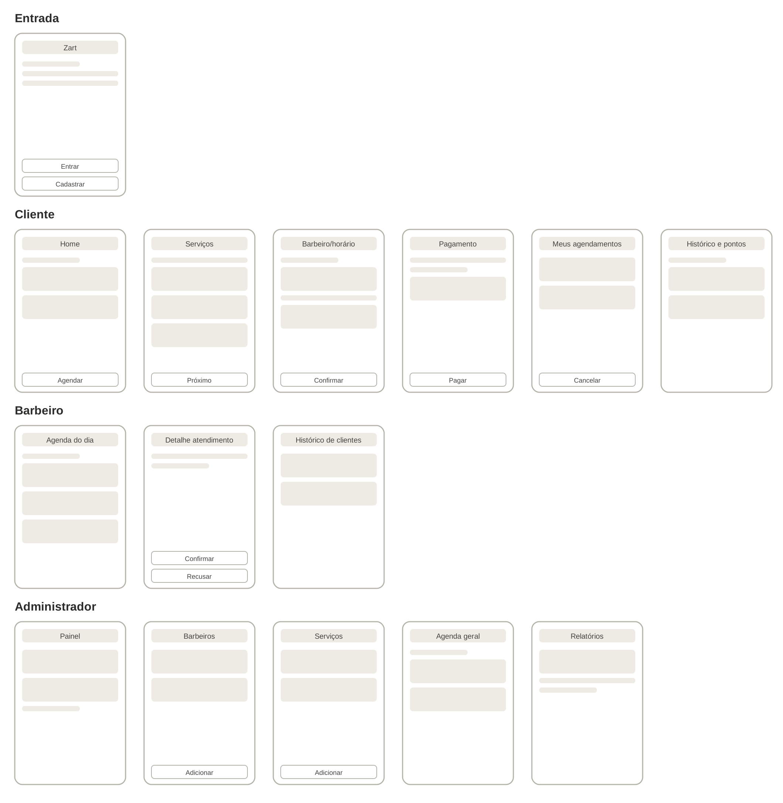
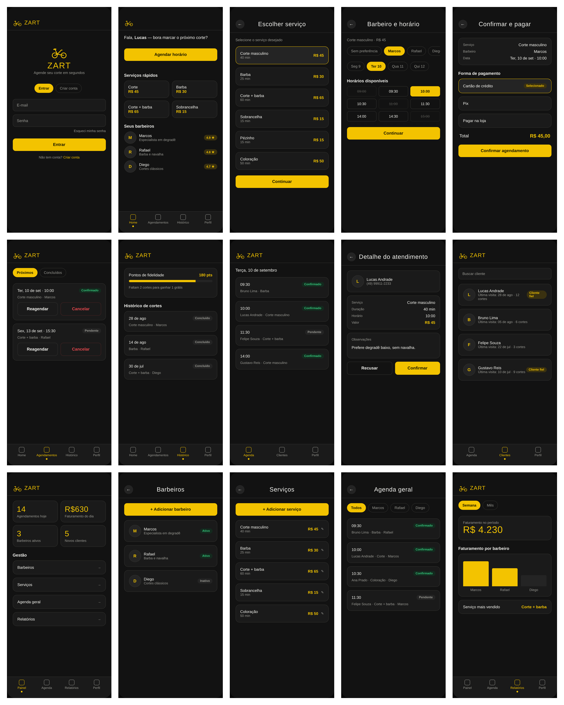

# 3. UX: navegação, wireframes e telas

## Mapa de navegação

### Entrada e roteamento por perfil

### Cliente

### Barbeiro

### Administrador

## Wireframes de baixa fidelidade

## Telas de alta fidelidade

Paleta: preto `#121212` como base, amarelo `#F3C300` nos destaques e botões principais, cinzas quentes para superfícies e textos secundários.

| Perfil | Telas |
|---|---|
| Entrada | [01 Login e cadastro](../design/telas/01-login-cadastro.png) |
| Cliente | [02 Home](../design/telas/02-cliente-home.png), [03 Selecionar serviço](../design/telas/03-cliente-selecionar-servico.png), [04 Barbeiro e horário](../design/telas/04-cliente-barbeiro-horario.png), [05 Confirmar e pagar](../design/telas/05-cliente-confirmar-pagamento.png), [06 Meus agendamentos](../design/telas/06-cliente-meus-agendamentos.png), [07 Histórico e fidelidade](../design/telas/07-cliente-historico-fidelidade.png) |
| Barbeiro | [08 Agenda do dia](../design/telas/08-barbeiro-agenda-dia.png), [09 Detalhe do atendimento](../design/telas/09-barbeiro-detalhe-atendimento.png), [10 Histórico de clientes](../design/telas/10-barbeiro-historico-clientes.png) |
| Administrador | [11 Painel](../design/telas/11-admin-painel.png), [12 Barbeiros](../design/telas/12-admin-barbeiros.png), [13 Serviços](../design/telas/13-admin-servicos.png), [14 Agenda geral](../design/telas/14-admin-agenda-geral.png), [15 Relatórios](../design/telas/15-admin-relatorios.png) |

## Protótipo navegável

O protótipo de alta fidelidade com navegação entre as telas fica no Figma. Link e capturas em [`design/prototipo-figma/`](../design/prototipo-figma).
